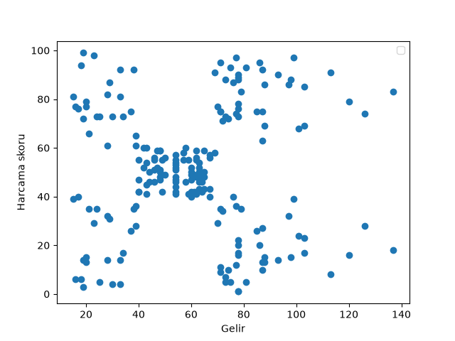
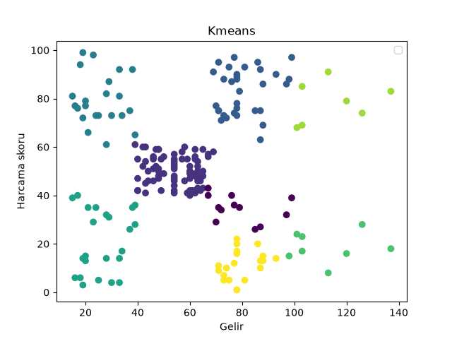
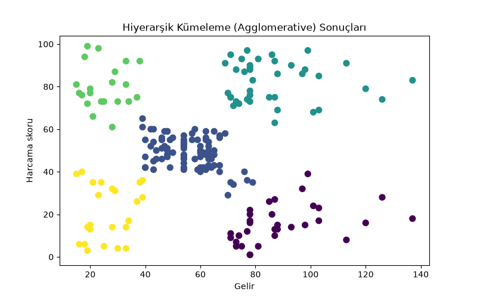
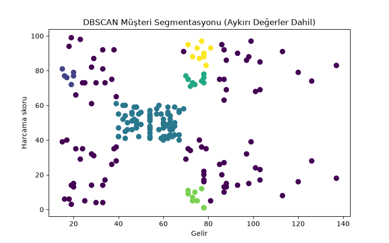

# 🚀 Customer Segmentation & Unsupervised Learning Pipeline

  <a href="#english">English</a> | <a href="#türkçe">Türkçe</a>

---

## 🇬🇧 English

### Project Overview
This project implements an end-to-end **Unsupervised Machine Learning** pipeline using **Python**, **Scikit-Learn**, and **Matplotlib** to perform customer segmentation on the popular [Mall Customers Dataset from Kaggle](https://www.kaggle.com/vjchoudhary7/customer-segmentation-tutorial-in-python). It explores and compares different clustering algorithms to group customers based on their annual income and spending score.

- **Dataset:** Dynamically fetched via `kagglehub` (`vjchoudhary7/customer-segmentation-tutorial-in-python`).
- **Features Used:** Annual Income (k$) and Spending Score (1-100).

---

### 📊 Exploratory Data Analysis & Visual Results

#### 1. Initial Data Distribution (Annual Income vs. Spending Score)

  

#### 2. K-Means Clustering Results

  

#### 3. Hierarchical (Agglomerative) Clustering Results

  

#### 4. DBSCAN Density-Based Clustering Results

  

---

### Key Engineering Decisions & Approach

1. **Dataset Integration & Exploration:**
   * Utilized `kagglehub` and `KaggleDatasetAdapter` to directly pull and load the dataset into a Pandas DataFrame.
   * Extracted raw numerical data arrays to visualize the initial distribution of customer income versus spending behavior using scatter plots.

2. **K-Means Clustering:**
   * Applied the **K-Means** algorithm (`KMeans(n_clusters=8)`) to partition the customer base into distinct groups, visualizing the multi-cluster centroid allocations and cluster boundaries.

3. **Hierarchical (Agglomerative) Clustering:**
   * Implemented **Agglomerative Clustering** (`AgglomerativeClustering(n_clusters=5)`) to build nested clusters hierarchically, capturing natural groupings using a custom colormap (`viridis`) for clear visual separation.

4. **DBSCAN Density-Based Clustering:**
   * Explored density-based spatial clustering (`DBSCAN(eps=5.0, min_samples=5)`) to identify arbitrarily shaped clusters and effectively handle noise/outliers within the customer dataset.

### 🛠 Tech Stack & Libraries
- **Language:** Python
- **Data Handling:** Pandas, NumPy
- **Machine Learning:** Scikit-Learn (KMeans, AgglomerativeClustering, DBSCAN)
- **Data Visualization:** Matplotlib
- **Dataset Source:** Kaggle Hub (`kagglehub`)

---
*Uncovering hidden patterns and data-driven customer insights through unsupervised learning.*

---

## 🇹🇷 Türkçe

### Proje Özeti
Bu proje, Kaggle üzerindeki popüler [Mall Customers Veri Seti](https://www.kaggle.com/vjchoudhary7/customer-segmentation-tutorial-in-python) ni kullanarak müşterileri yıllık gelirleri ve harcama skorlarına göre gruplandıran, **Python**, **Scikit-Learn** ve **Matplotlib** tabanlı uçtan uca bir **Gözetimsiz Makine Öğrenmesi (Unsupervised Learning)** boru hattıdır. Farklı kümeleme algoritmalarını uygulayarak karşılaştırır.

- **Veri Seti:** `kagglehub` (`vjchoudhary7/customer-segmentation-tutorial-in-python`) kullanılarak dinamik olarak indirilmiştir.
- **Kullanılan Özellikler:** Yıllık Gelir (Annual Income) ve Harcama Skoru (Spending Score).

---

### 📊 Keşifsel Veri Analizi ve Görsel Sonuçlar

#### 1. Başlangıç Veri Dağılımı (Gelir vs. Harcama Skoru)

  

#### 2. K-Means Kümeleme Sonuçları

  

#### 3. Hiyerarşik (Agglomerative) Kümeleme Sonuçları

  

#### 4. DBSCAN Yoğunluk Tabanlı Kümeleme Sonuçları

  

---

### Mühendislik Kararları ve Yaklaşım

1. **Veri Seti Entegrasyonu ve Keşfi:**
   * `kagglehub` ve `KaggleDatasetAdapter` kullanılarak veri seti doğrudan Pandas DataFrame yapısına aktarılmıştır.
   * Müşterilerin gelir ve harcama dağılımlarını incelemek üzere başlangıç görselleştirmeleri (scatter plot) gerçekleştirilmiştir.

2. **K-Means Kümeleme:**
   * Müşteri tabanını gruplara ayırmak için **K-Means** algoritması (`KMeans(n_clusters=8)`) uygulanmış ve sonuçlar görselleştirilmiştir.

3. **Hiyerarşik (Agglomerative) Kümeleme:**
   * Doğal grupları yakalamak amacıyla **Hiyerarşik Kümeleme** (`AgglomerativeClustering(n_clusters=5)`) entegre edilmiş, `viridis` renk haritası ile net bir görsel ayrım sağlanmıştır.

4. **DBSCAN Yoğunluk Tabanlı Kümeleme:**
   * Verideki gürültüleri ve aykırı değerleri (outliers) yakalayabilmek için yoğunluk tabanlı **DBSCAN** algoritması (`DBSCAN(eps=5.0, min_samples=5)`) test edilmiştir.

### 🛠 Teknoloji Yığını ve Kütüphaneler
- **Dil:** Python
- **Veri İşleme:** Pandas, NumPy
- **Makine Öğrenmesi:** Scikit-Learn (KMeans, AgglomerativeClustering, DBSCAN)
- **Veri Görselleştirme:** Matplotlib
- **Veri Kaynağı:** Kaggle Hub (`kagglehub`)

---
*Gözetimsiz öğrenme ile gizli örüntüleri ve veri odaklı müşteri içgörülerini keşfetmek.*