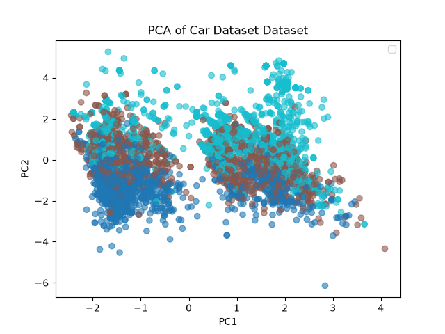
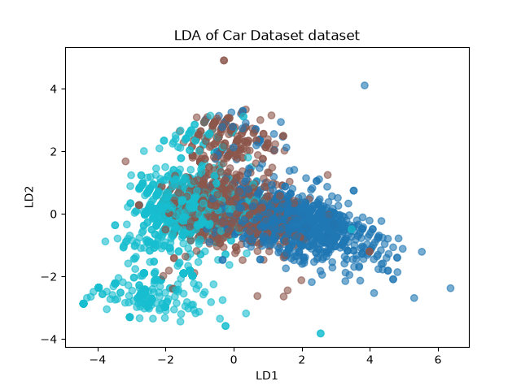
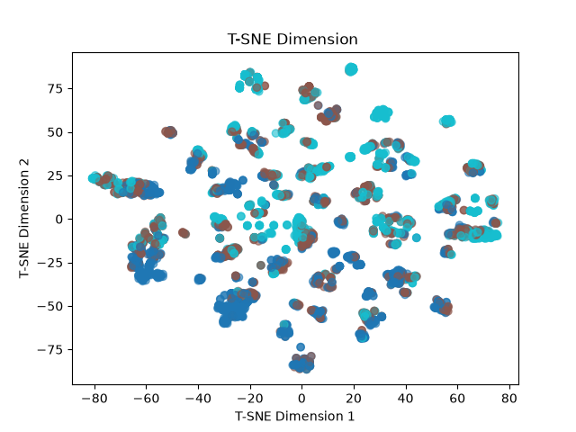

# Car Dataset Dimensionality Reduction (PCA, LDA & T-SNE)

  <a href="#english">English</a> | <a href="#türkçe">Türkçe</a>

---

## 🇬🇧 English

### Project Overview
This project implements an end-to-end **Dimensionality Reduction and Feature Extraction** pipeline using **Python**, **Scikit-Learn**, and **Matplotlib** on the [Car Details from Car Dekho Dataset](https://www.kaggle.com/datasets/akshaydattatraykhare/car-details-dataset). It explores, compares, and visualizes high-dimensional car features in a 2D space using both unsupervised and supervised projection techniques.

- **Dataset:** Dynamically fetched via `kagglehub` (`akshaydattatraykhare/car-details-dataset`).
- **Target Engineering:** Converted continuous selling prices into discrete classes using quantile-based discretization (`pd.qcut`) for supervised projection.

### Key Engineering Decisions & Approach
1. **Preprocessing & Feature Engineering:**
   * Extracted the primary car brand from the raw `name` string to avoid extreme high cardinality.
   * Applied One-Hot Encoding (`drop_first=True`) and standardized features using `StandardScaler` to ensure zero mean and unit variance across features.
2. **Dimensionality Reduction Techniques & Visualizations:**
   * **PCA (Principal Component Analysis):** An unsupervised linear transformation maximizing variance across 2 principal components to capture global data variance.
     
     

       
     

   * **LDA (Linear Discriminant Analysis):** A supervised linear transformation leveraging price quantile classes ($y$) to maximize class separability.
     
     

       
     

   * **T-SNE (t-Distributed Stochastic Neighbor Embedding):** A non-linear dimensionality reduction technique capturing complex local structures and clusters.
     
     

       
     

### 🛠 Tech Stack & Libraries
- **Language:** Python
- **Data Handling:** Pandas, NumPy
- **Machine Learning:** Scikit-Learn (PCA, LDA, TSNE, StandardScaler)
- **Data Visualization:** Matplotlib
- **Dataset Source:** Kaggle Hub (`kagglehub`)

---
*Unveiling high-dimensional data structures through advanced projection techniques.*

---

## 🇹🇷 Türkçe

### Proje Özeti
Bu proje, [Car Details from Car Dekho Veri Seti](https://www.kaggle.com/datasets/akshaydattatraykhare/car-details-dataset) üzerinde **Python**, **Scikit-Learn** ve **Matplotlib** kullanarak uçtan uca bir **Boyut İndirgeme ve Özellik Çıkarma** boru hattı uygular. Yüksek boyutlu araba özelliklerini 2 boyutta görselleştirmek ve incelemek için denetimsiz ve denetimli projeksiyon tekniklerini karşılaştırır.

- **Veri Seti:** `kagglehub` (`akshaydattatraykhare/car-details-dataset`) kullanılarak dinamik olarak indirilmiştir.
- **Hedef Mühendisliği:** Sürekli satış fiyatları, denetimli projeksiyon için nicem tabanlı gruplamaya (`pd.qcut`) tabi tutularak ayrık sınıflara dönüştürülmüştür.

### Mühendislik Kararları ve Yaklaşım
1. **Ön İşleme ve Özellik Mühendisliği:**
   * Aşırı yüksek kardinaliteyi önlemek amacıyla ham `name` sütunundan ana araba markası çıkarılmıştır.
   * One-Hot Encoding (`drop_first=True`) uygulanmış ve özellikler `StandardScaler` ile ölçeklendirilmiştir.
2. **Boyut İndirgeme Teknikleri ve Görselleştirmeler:**
   * **PCA (Temel Bileşen Analizi):** Global veri varyansını yakalamak için 2 temel bileşen üzerinde varyansı maksimize eden denetimsiz doğrusal dönüşüm.
     
     

       
     

   * **LDA (Doğrusal Ayırıcı Analiz):** Sınıf ayrılabilirliğini maksimize etmek için fiyat sınıflarını ($y$) kullanan denetimli doğrusal dönüşüm.
     
     

       
     

   * **T-SNE:** Karmaşık yerel yapıları ve kümeleri açığa çıkaran doğrusal olmayan boyut indirgeme yöntemi.
     
     

       
     

### 🛠 Teknoloji Yığını ve Kütüphaneler
- **Dil:** Python
- **Veri İşleme:** Pandas, NumPy
- **Makine Öğrenmesi:** Scikit-Learn (PCA, LDA, TSNE, StandardScaler)
- **Veri Görselleştirme:** Matplotlib
- **Veri Kaynağı:** Kaggle Hub (`kagglehub`)

---
*Gelişmiş projeksiyon teknikleriyle yüksek boyutlu veri yapılarını açığa çıkarmak.*