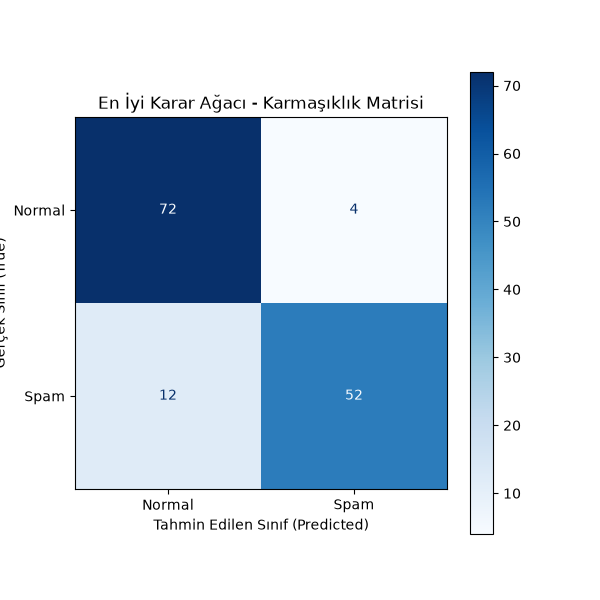
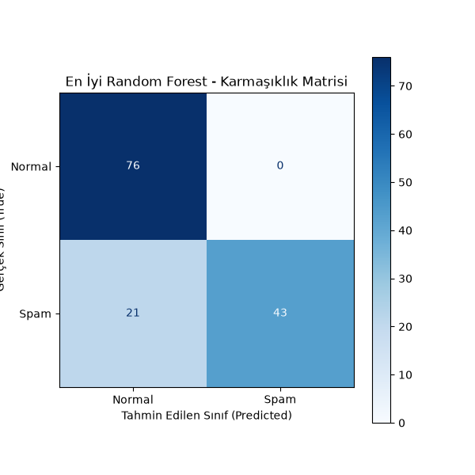
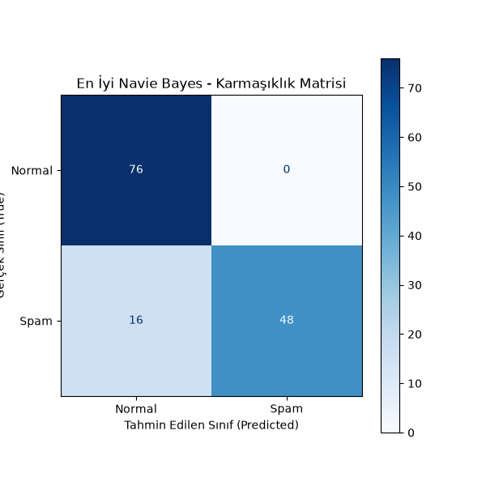
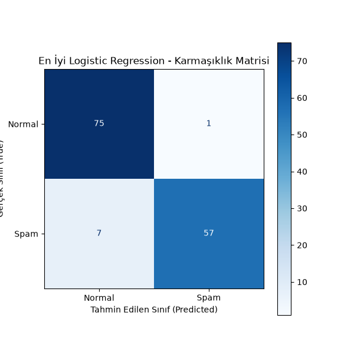

# Turkish Spam Classification (NLP & Supervised Learning Pipeline)

  <a href="#english">English</a> | <a href="#türkçe">Türkçe</a>

---

## 🇬🇧 English

### Project Overview
This project implements an end-to-end **Natural Language Processing (NLP)** and text classification pipeline using **Python**, **Scikit-Learn**, and **Matplotlib**. It processes the [Turkish Spam Dataset](https://www.kaggle.com/datasets/cuneytdemir/turkish-spam-dataset) via `kagglehub`, cleans text data, transforms raw messages into numerical feature vectors using **TF-IDF**, and evaluates multiple supervised machine learning models with hyperparameter tuning and 5-fold cross-validation.

- **Dataset:** Dynamically fetched via `kagglehub` (`cuneytdemir/turkish-spam-dataset`)[cite: 2].
- **Text Vectorization:** Converted raw text messages into numerical feature representations using `TfidfVectorizer`[cite: 2].

### Key Engineering Decisions & Approach
1. **Data Preprocessing & Cleaning:**
   * Handled potential formatting issues and bad lines using custom `pandas_kwargs` (`on_bad_lines="skip"`, `encoding="utf-8"`)[cite: 2].
   * Dropped missing values to ensure data integrity across 700 clean samples[cite: 2].
2. **Model Training, Optimization & Evaluation:**
   * **Decision Tree Classifier:** Optimized via `GridSearchCV` and 5-fold cross-validation (`KFold`), achieving an accuracy score of **88.93%**[cite: 2].
     
     

       
     

   * **Random Forest Classifier:** Trained with hyperparameter tuning, yielding an accuracy score of **88.21%**[cite: 2].
     
     

       
     

   * **Multinomial Naive Bayes:** Implemented as a strong probabilistic baseline, reaching an accuracy of **89.28%**[cite: 2].
     
     

       
     

   * **Logistic Regression:** Optimized with the `saga` solver across regularization parameters, achieving the **highest performance** with an accuracy score of **91.61%** and a test accuracy of **94%**[cite: 2].
     
     

       
     

3. **Performance Metrics:** Evaluated models using detailed classification reports (`precision`, `recall`, `f1-score`) alongside custom-styled `ConfusionMatrixDisplay` plots[cite: 2].

### 🛠 Tech Stack & Libraries
- **Language:** Python[cite: 2]
- **Data Handling:** Pandas, NumPy[cite: 2]
- **NLP & Text Vectorization:** Scikit-Learn (`TfidfVectorizer`)[cite: 2]
- **Machine Learning & Evaluation:** Scikit-Learn (`DecisionTreeClassifier`, `RandomForestClassifier`, `MultinomialNB`, `LogisticRegression`, `GridSearchCV`, `KFold`, `classification_report`)[cite: 2]
- **Data Visualization:** Matplotlib[cite: 2]
- **Dataset Source:** Kaggle Hub (`kagglehub`)[cite: 2]

---
*Transforming text data into actionable insights through robust NLP pipelines.*

---

## 🇹🇷 Türkçe

### Proje Özeti
Bu proje, **Python**, **Scikit-Learn** ve **Matplotlib** kullanarak uçtan uca bir **Doğal Dil İşleme (NLP)** ve metin sınıflandırma boru hattı uygular. `kagglehub` üzerinden [Turkish Spam Dataset](https://www.kaggle.com/datasets/cuneytdemir/turkish-spam-dataset) veri setini dinamik olarak yükler; metinleri temizler, **TF-IDF** ile sayısal vektörlere dönüştürür ve hiperparametre optimizasyonu ile çapraz doğrulama eşliğinde birden fazla makine öğrenmesi algoritmasını karşılaştırır[cite: 2].

- **Veri Seti:** `kagglehub` (`cuneytdemir/turkish-spam-dataset`) kullanılarak dinamik olarak indirilmiştir[cite: 2].
- **Metin Vektörleştirme:** Ham metin mesajları `TfidfVectorizer` kullanılarak sayısal özellik matrislerine dönüştürülmüştür[cite: 2].

### Mühendislik Kararları ve Yaklaşım
1. **Veri Ön İşleme ve Temizleme:**
   * `pandas_kwargs` ayarları (`on_bad_lines="skip"`, `encoding="utf-8"`) kullanılarak olası biçimlendirme hataları ve bozuk satırlar güvenli bir şekilde ele alınmıştır[cite: 2].
   * Eksik veriler temizlenerek toplam 700 temiz örnek üzerinden çalışılmıştır[cite: 2].
2. **Model Eğitimi, Optimizasyon ve Değerlendirme:**
   * **Karar Ağacı (Decision Tree):** `GridSearchCV` ve 5 katlı çapraz doğrulama (`KFold`) ile optimize edilmiş, **%88.93** doğruluk skoru elde etmiştir[cite: 2].
     
     

       
     

   * **Rastgele Orman (Random Forest):** Hiperparametre optimizasyonu ile eğitilmiş ve **%88.21** doğruluk skoru elde etmiştir[cite: 2].
     
     

       
     

   * **Multinomial Naive Bayes:** Olasılıksal temel model olarak kurulmuş ve **%89.28** doğruluk oranına ulaşmıştır[cite: 2].
     
     

       
     

   * **Lojistik Regresyon (Logistic Regression):** `saga` çözücüsü ve optimize edilmiş hiperparametrelerle **%91.61** çapraz doğrulama skoru ve test setinde **%94** doğruluk oranıyla **en iyi performansı** göstermiştir[cite: 2].
     
     

       
     

3. **Performans Metrikleri:** Modeller, detaylı sınıflandırma raporları (`precision`, `recall`, `f1-score`) ve özelleştirilmiş `ConfusionMatrixDisplay` grafikleriyle değerlendirilmiştir[cite: 2].

### 🛠 Teknoloji Yığını ve Kütüphaneler
- **Dil:** Python[cite: 2]
- **Veri İşleme:** Pandas, NumPy[cite: 2]
- **NLP ve Vektörleştirme:** Scikit-Learn (`TfidfVectorizer`)[cite: 2]
- **Makine Öğrenmesi ve Değerlendirme:** Scikit-Learn (`DecisionTreeClassifier`, `RandomForestClassifier`, `MultinomialNB`, `LogisticRegression`, `GridSearchCV`, `KFold`, `classification_report`)[cite: 2]
- **Veri Görselleştirme:** Matplotlib[cite: 2]
- **Veri Kaynağı:** Kaggle Hub (`kagglehub`)[cite: 2]

---
*Sağlam NLP boru hatlarıyla metin verilerini eyleme dönüştürülebilir içgörülere çevirmek.*[cite: 2]